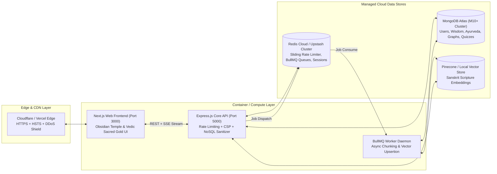

# AI Gurukul 2.0 – Production Deployment & Operations Guide

> **Target System**: AI Gurukul – Ancient Wisdom for Modern Life  
> **Milestone**: Phase 8 Production Hardening, Security Hardening & Cloud Readiness  
> **Platform Stack**: Next.js 14 (Web), Express.js + TypeScript (API), BullMQ (Worker), MongoDB 7.0 (Mongoose), Redis 7

---

## 1. System Architecture Overview



---

## 2. Managed Cloud Infrastructure Setup

### A. MongoDB Atlas Setup (Primary Database)
1. Navigate to [MongoDB Atlas](https://www.mongodb.com/cloud/atlas) and create an organization and project.
2. Deploy a cluster:
   - **Tier**: M0 (Free tier for staging/demo) or M10+ (Dedicated cluster for production).
   - **Region**: Choose closest to your API deployment (e.g. `ap-south-1` Mumbai or `us-east-1`).
3. **Database Access**: Create a dedicated application user with `readWriteAnyDatabase` privileges.
4. **Network Access**: Add the static IP addresses of your API and Worker containers, or allow `0.0.0.0/0` with strong password authentication and TLS.
5. **Connection String**:
   ```env
   MONGODB_URI="mongodb+srv://<username>:<password>@cluster0.aigurukul.mongodb.net/aigurukul_prod?retryWrites=true&w=majority&appName=AIGurukul"
   ```

### B. Redis Cloud / Upstash Setup (Queue & Cache)
1. Deploy an instance on [Redis Cloud](https://redis.io/cloud/) or [Upstash](https://upstash.com/).
2. Enable TLS (SSL) in production.
3. Configure persistence: **AOF (Append-Only File)** enabled to prevent queue job loss.
4. **Connection String**:
   ```env
   REDIS_URL="redis://default:<password>@<host>:<port>"
   ```

---

## 3. Cryptographic Secret Generation & Environment Configuration

Generate strong 32-byte cryptographic keys using Node.js crypto CLI:
```bash
node -e "console.log('JWT_ACCESS_SECRET=' + require('crypto').randomBytes(32).toString('hex'))"
node -e "console.log('JWT_REFRESH_SECRET=' + require('crypto').randomBytes(32).toString('hex'))"
node -e "console.log('COOKIE_SECRET=' + require('crypto').randomBytes(32).toString('hex'))"
```

### Complete Production Environment Variables (`.env.production`)

```env
# =========================================================================
# Server & Runtime Configuration
# =========================================================================
NODE_ENV=production
PORT=5000
CORS_ORIGIN=https://aigurukul.vercel.app

# =========================================================================
# Database & Cache Connections
# =========================================================================
MONGODB_URI=mongodb+srv://<user>:<pass>@<cluster>.mongodb.net/aigurukul_prod?retryWrites=true&w=majority
REDIS_URL=redis://default:<password>@<redis-host>:<port>

# =========================================================================
# Security & Cryptographic Secrets
# =========================================================================
JWT_ACCESS_SECRET=0123456789abcdef0123456789abcdef0123456789abcdef0123456789abcdef
JWT_REFRESH_SECRET=fedcba9876543210fedcba9876543210fedcba9876543210fedcba9876543210
COOKIE_SECRET=abcdef0123456789abcdef0123456789abcdef0123456789abcdef0123456789

# =========================================================================
# AI & Vector Store Providers
# =========================================================================
AI_PROVIDER=local
EMBEDDING_PROVIDER=local
VECTOR_STORE_PROVIDER=local
STORAGE_PROVIDER=local

# Optional External Providers (When switching from local mock to cloud LLMs):
# OPENAI_API_KEY=sk-...
# ANTHROPIC_API_KEY=sk-ant-...
# GEMINI_API_KEY=AIzaSy...
# PINECONE_API_KEY=...
# PINECONE_INDEX=vedic-scriptures

# =========================================================================
# Web Client Environment
# =========================================================================
NEXT_PUBLIC_API_URL=https://api.aigurukul.com/api/v1
```

---

## 4. Docker Production Orchestration

To run the complete production stack locally or on an EC2 / VPS instance:

```bash
# 1. Clone repository
git clone https://github.com/bhumishah2411/AiGurukul-2.0.git
cd AiGurukul-2.0

# 2. Configure production environment
cp .env.example .env.production
# (Edit .env.production with your production secrets)

# 3. Build and launch all services in detached mode
docker compose -f docker/docker-compose.prod.yml --env-file .env.production up -d --build

# 4. Verify running services and health status
docker compose -f docker/docker-compose.prod.yml ps

# 5. Inspect container logs
docker compose -f docker/docker-compose.prod.yml logs -f api
```

---

## 5. Cloud Platform Deployments

### A. Deploying Web Client (`apps/web`) to Vercel
1. Link your GitHub repository to [Vercel](https://vercel.com).
2. Configure **Root Directory**: `apps/web`.
3. Set **Framework Preset**: `Next.js`.
4. Configure **Build Command**: `npx turbo run build --filter=@ai-gurukul/web`.
5. Add Environment Variables:
   - `NEXT_PUBLIC_API_URL`: `https://your-api-domain.com/api/v1`

### B. Deploying Core API (`apps/api`) & Worker to Render / Railway / Fly.io
1. Create a new **Web Service** on Render / Railway pointing to your repository.
2. Select **Dockerfile** deployment:
   - **Dockerfile Path**: `apps/api/Dockerfile`
   - **Docker Context**: `.` (Repository root)
3. Set Environment Variables listed in Section 3.
4. Set Health Check path: `/health/live`.
5. Repeat for `apps/worker` using `apps/worker/Dockerfile` as a **Background Worker** service.

---

## 6. Pre-Flight Security & Operational Checklist

| Check | Requirement | Verification Command |
| :--- | :--- | :--- |
| **All Test Suites** | 100% pass across all 21 test suites | `npm test` |
| **Typecheck** | 0 TypeScript errors across 12 packages | `npm run typecheck` |
| **ESLint** | 0 warnings and 0 errors | `npm run lint` |
| **Next.js Production Build** | All routes pre-rendered statically | `npm run build` |
| **Rate Limiter** | Blocks abuse with 429 & Retry-After | Covered in `apps/api/src/security.test.ts` |
| **NoSQL Sanitization** | Drops `$` and `.` injection keys | Covered in `apps/api/src/security.test.ts` |
| **Security Headers** | CSP, HSTS, X-Content-Type-Options | Covered in `apps/api/src/security.test.ts` |
| **Health Checks** | `/health/live` & `/health/ready` | HTTP 200 OK |
| **Database Seeds** | Seed canonical nodes & shlokas | `npm run seed` in packages/database |

---

## 7. Zero-Downtime Rolling Update Strategy

When pushing updates in production:
1. **GitHub Actions CI Quality Gates** automatically run linting, typechecks, Vitest tests, and build validation.
2. Docker images are tagged with git SHA commit hashes (`aigurukul/api:<sha>`).
3. Containers are updated via rolling blue-green deployment:
   ```bash
   docker compose -f docker/docker-compose.prod.yml up -d --no-deps --build api
   ```
4. The load balancer continues routing traffic to healthy instances until new instances pass their `/health/live` check.
